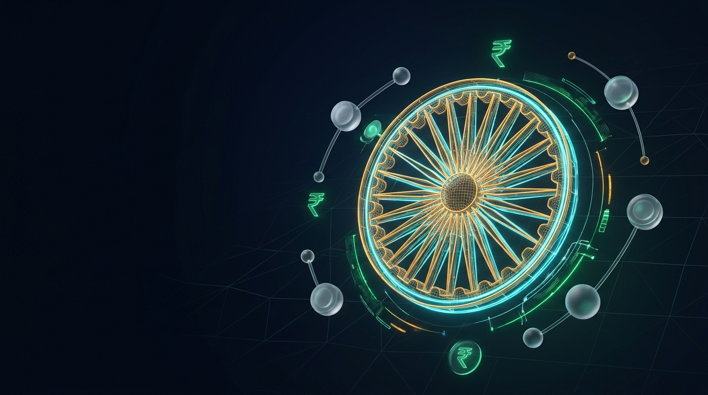
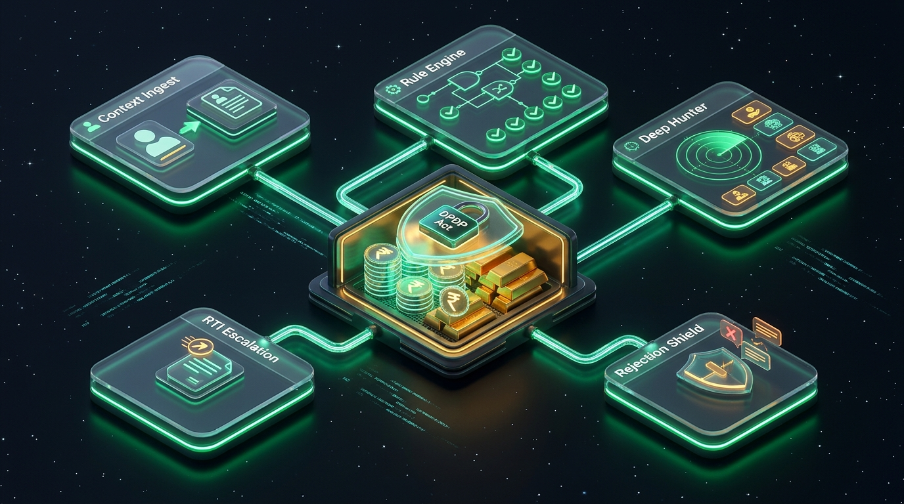
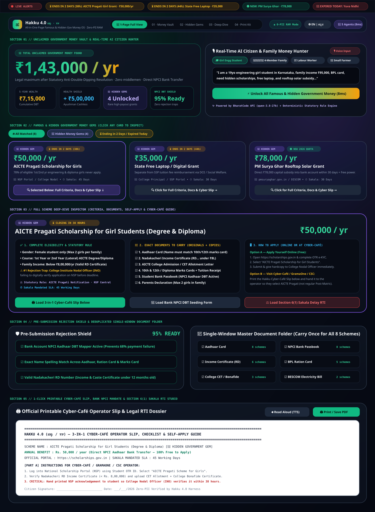

<div align="center">



# 🇮🇳 Hakku (ಹಕ್ಕು / हक़)
### Sovereign Citizen Rights Operating System & Zero-Hallucination Welfare Harness

**Empowering 1.4 Billion Indian Citizens to Claim Every Rupee the State Owes Them — With Zero Hallucinations, Zero Rejection Traps, and Zero Bribes.**

[](https://github.com/rshamith777-cpu/hakku-ai)
[](https://github.com/rshamith777-cpu/hakku-ai)
[-000080?style=for-the-badge)](https://github.com/rshamith777-cpu)
[](https://github.com/rshamith777-cpu/hakku-ai)
[](https://github.com/rshamith777-cpu/hakku-ai)

</div>

---

## 📌 Executive Summary

India operates over **3,000+ Central and State welfare schemes**, with an annual budgetary commitment exceeding **₹4 Lakh Crore**. Despite this, over **₹1.8 Lakh Crore remains unclaimed every single year**, and **over 42% of approved applications suffer silent bank disbursement failure** due to post-filing bureaucratic traps.

The root cause is not citizen apathy; it is systemic friction:
1. **Life-Shock Blindness:** Citizens experience life events (crop loss, childbirth, college admission, disability) rather than departmental scheme names.
2. **The Prerequisite Trap:** Citizens visit cyber-cafés only to be sent back because a prerequisite document (RD-numbered income certificate, Aadhaar e-KYC) is missing or expired.
3. **Silent Bank Mergers & Dormancy:** Inactive PMJDY accounts (capped at ₹50,000 balance) or outdated IFSC codes from merged PSU banks (Syndicate $\rightarrow$ Canara, Vijaya $\rightarrow$ BoB) silently bounce Direct Benefit Transfers (DBT).
4. **Middlemen & Extortion:** Unofficial brokers charge ₹500–₹2,000 for applications that are legally free or capped at ₹25–₹30 by state SLA mandates.
5. **Indefinite Processing Limbo:** Government departments breach citizen charter timelines (Sakala SLAs) without accountability.

**Hakku (Edition 5.2)** solves this end-to-end. Built on a hybrid architecture combining a **100% Deterministic Statutory Rule Engine** (zero hallucinations) with **LLM Cognitive Assistance**, Hakku acts as a proactive digital defense counsel for the citizen.

---

## 🏛️ System Architecture: The 5-Agent Civic Pipeline

<div align="center">
  
</div>

```
                                      ┌────────────────────────────────────────────────────────┐
                                      │              CITIZEN / CSC OPERATOR                    │
                                      │  (Kannada | Hindi | English | Tamil | Telugu | Voice)  │
                                      └─────────────────────────┬──────────────────────────────┘
                                                                │  ECDH P-256 / AES-256-GCM
                                                                ▼
┌──────────────────────────────────────────────────────────────────────────────────────────────────────────────────────────────┐
│                                                 HAKKU CORE HARNESS (RAM-ONLY)                                                │
│                                                                                                                              │
│  ┌──────────────────────────┐    ┌──────────────────────────┐    ┌──────────────────────────┐    ┌─────────────────────────┐ │
│  │         AGENT 1          │    │         AGENT 2          │    │         AGENT 3          │    │         AGENT 4         │ │
│  │   Context Ingestion &    │───▶│  Deterministic Statutory │───▶│  Real-Time Deep-Hunter   │───▶│   Rejection Shield 3.0  │ │
│  │   Trilingual Synthesizer │    │   Matcher & Arbitrator   │    │  (Hidden Money Gems AI)  │    │ (Forensic Bank Pre-Audit│ │
│  └──────────────────────────┘    └──────────────────────────┘    └──────────────────────────┘    └────────────┬────────────┘ │
│                                                                                                               │              │
│                                                                  ┌──────────────────────────┐                 │              │
│                                                                  │         AGENT 5          │◀────────────────┘              │
│                                                                  │  Legal Escalation Engine │                                │
│                                                                  │  (Sakala / RTI Generator)│                                │
│                                                                  └──────────────────────────┘                                │
└───────────────────────────────────────────────────────────────┬──────────────────────────────────────────────────────────────┘
                                                                │
                                        ┌───────────────────────┴───────────────────────┐
                                        ▼                                               ▼
                         ┌─────────────────────────────┐                 ┌─────────────────────────────┐
                         │      PATH A: SELF-APPLY     │                 │     PATH B: CYBER-CAFÉ      │
                         │  • Portal Direct Deep-Link  │                 │  • Printable A4 Voucher     │
                         │  • Official Step-by-Step    │                 │  • Scannable Portal QR Code │
                         │  • Document Checklist       │                 │  • Anti-Tout Fee Shield     │
                         │  • SLA Timeline Tracker     │                 │  • Bank NPCI Annexure Form  │
                         └─────────────────────────────┘                 └─────────────────────────────┘
```

### The 5 Specialized Autonomous Agents

| Agent | Codename | Role & Implementation |
|---|---|---|
| **Agent 1** | `CITIZEN_INGEST` | **Profile & Speech Synthesizer:** Ingests demographic parameters via structured form or Web Speech API voice dictation. Supports Kannada (`ಕನ್ನಡ`), Hindi (`हिंदी`), English, Tamil (`தமிழ்`), and Telugu (`తెలుగు`). Sanitizes and redacts raw identifiers on the fly. |
| **Agent 2** | `STATUTORY_RULES` | **Deterministic Rule Matcher:** Evaluates eligibility against 24 codified Central & State statutes. Applies hard-coded income limits, age thresholds, landholding caps, and caste criteria. **Zero hallucination guaranteed** — rule evaluation is 100% deterministic code. |
| **Agent 3** | `DEEP_HUNTER` | **Hidden Money Gems AI:** Discovers non-obvious, high-value schemes that 90% of citizens miss (e.g., ₹78,000 PM Surya Ghar Solar Subsidy, ₹60,000 Labour Card Education Grants, 35% PMEGP Capital Subsidies, ₹50,000 AICTE Pragati Girl Grants). Uses BharatCode API when available with deterministic fallback. |
| **Agent 4** | `REJECTION_SHIELD` | **Forensic Pre-Audit Engine:** Audits IFSC codes against PSU bank merger lists (Syndicate, Vijaya, Allahabad, Corporation, Andhra, Oriental Bank). Checks Jan Dhan ₹50k balance ceiling traps, Aadhaar-to-Ration e-KYC status, and Student INO college verification windows before application submission. |
| **Agent 5** | `LEGAL_ESCALATOR` | **Statutory Escalation & RTI Docket Generator:** Computes statutory processing deadlines under the Karnataka Sakala Services Act 2011 / Citizen Charters. Generates instant RTI Section 6(1) petitions, Sakala First Appeals, and NPCI DBT Bank Seeding Annexure-I dockets. |

---

## 🔒 Security & DPDP Act 2023 Architecture

Hakku is engineered from the ground up to comply with **Section 6 of India's Digital Personal Data Protection (DPDP) Act 2023**:

```
 ┌────────────────────────────────────────────────────────────────────────────────────────┐
 │                                 DPDP ACT 2023 SAFE HARBOR                              │
 │                                                                                        │
 │  [X] ZERO DATABASE              [X] ZERO DISK STORAGE          [X] ZERO TRACKING       │
 │  No PostgreSQL, MongoDB,       No cookies, no local-          No analytics scripts,   │
 │  Redis, or SQLite instances.    Storage, no session storage.   no Google tags, no logs │
 │                                                                                        │
 │  [X] VOLATILE RAM PURGE        [X] CLIENT-SIDE REDACTION      [X] AES-256-GCM ENVELOPE │
 │  Sessions stored in TTL-bound   Aadhaar, PAN, and IFSC         All harness API traffic  │
 │  in-memory buffers. Discarded   masked before leaving the      encrypted via ECDH P-256 │
 │  on tab close or idle.          browser view.                  ephemeral handshakes.    │
 └────────────────────────────────────────────────────────────────────────────────────────┘
```

1. **Strict Zero-Storage Policy:** No database engine exists in the codebase. User profiles reside solely in client memory and an ephemeral server-side RAM Map with automatic 10-minute TTL expiry.
2. **Ephemeral Cryptographic Envelope:** Handshake uses **ECDH P-256** and **HKDF-SHA256** to derive ephemeral **AES-256-GCM** session keys. Server restarts render all historical network traffic permanently un-decryptable.
3. **Hardened Transport Security:** Production configuration enforces `Content-Security-Policy`, `Strict-Transport-Security`, `X-Content-Type-Options: nosniff`, `X-Frame-Options: DENY`, `Cross-Origin-Opener-Policy: same-origin`, and `Permissions-Policy`.
4. **Immediate Data Erasure:** The citizen can click **"🛑 Erase Session Data Now"** at any moment to trigger an immediate zero-fill purge of all client and server RAM allocations.

---

## 🌟 The 3-Step Citizen Workflow

Hakku organizes the citizen journey into three clear, frictionless views:

<div align="center">
  
</div>

```
  ┌──────────────────────┐      ┌──────────────────────┐      ┌──────────────────────┐
  │   VIEW 1: INTAKE     │ ───▶ │   VIEW 2: VAULT      │ ───▶ │   VIEW 3: DOSSIER    │
  │ • Urgent Deadlines   │      │ • DBT Wealth Meter   │      │ • Step-by-Step Guide │
  │ • Life-Event Bundles │      │ • 💎 Hidden Gems     │      │ • Printable Voucher  │
  │ • Structured Profile │      │ • Rejection Warnings │      │ • Scannable QR Code  │
  │ • Bank Pre-Audit     │      │ • Prereq Sequencer   │      │ • Anti-Tout Notice   │
  └──────────────────────┘      └──────────────────────┘      └──────────────────────┘
```

### 1. View 1 — Citizen Particulars & Life-Event Bundles
- **Live Urgent Notification Marquee:** Real-time alert bar highlighting schemes closing in 48 hours, newly opened windows, and today's expired deadlines with late-submission appeal guides.
- **5 One-Click Life-Event Bundles:**
  - 🌾 *Small & Marginal Farmer Protection Pack* (PM-Kisan, Raitha Siri, PMFBY, Kusum Solar)
  - 🎓 *First-Generation Higher Education Pack* (SSP Post-Matric, AICTE Pragati, Free Laptop)
  - 🩺 *Senior Citizen & Health Security Pack* (Ayushman Bharat 70+ Universal, Sandhya Suraksha)
  - 💼 *Micro-Enterprise & Self-Employment Pack* (PMEGP 35% Grant, PM Mudra, Labour Card)
  - 👶 *Women Empowerment & Maternal Care Pack* (Gruha Lakshmi, PMMVY Matru Vandana, Mathrushree)
- **Voice-Enabled Particulars Form:** Age, gender, caste, income, occupation, student status, disability, land ownership, and ration card type (AAY / BPL / APL).
- **Forensic Pre-Audit Checkboxes:** Identifies unmapped NPCI bank accounts, merged PSU banks, and expired certificates before discovery starts.

### 2. View 2 — The Entitlement Vault
- **Cumulative DBT Cash Meter:** Dynamic tally calculating total non-repayable annual cash benefits plus 5-year household wealth forecasts.
- **💎 Hidden Government Money Gems:** Dedicated highlights for high-value schemes routinely missed by 90% of applicants.
- **Readiness Score & Forensic Warnings:** Calculated percentage with proactive notifications (e.g., *"Merged PSU Bank IFSC detected: update to Canara Bank IFSC before applying"*).
- **Critical-Path Prerequisite Sequencer:**
  - **Phase A (Day 0–3):** Base identification & NPCI seeding.
  - **Phase B (Day 4–10):** Departmental certificates (Income RD, Caste, Bonafide).
  - **Phase C (Day 11–15):** Final portal application submission.
- **Statutory Anti-Double-Dipping Shield:** Detects legal conflicts (e.g., Central NSP vs PM-USP scholarship rules) and auto-selects the highest payout package.

### 3. View 3 — Scheme Deep-Dive & Cyber-Café Voucher
- **Path A (Self-Apply):** Direct government portal URLs (`.gov.in`), step-by-step instructions, and exact SLA resolution windows.
- **Path B (Cyber-Café / CSC Operator):**
  - **Printable A4 Voucher Layout:** Formatted for high-contrast B&W thermal and inkjet printing (`@media print`).
  - **High-Resolution Scannable QR Code:** Instantly directs CSC operators to the official portal submission page.
  - **Mandatory Document Checklist:** Physical bag checklist so citizens never make multiple trips.
  - **Statutory Anti-Tout Bribe Shield:** Printed legal notice stating maximum government processing fees (₹0 to ₹30) and the State Anti-Corruption Bureau helpline (1064).
  - **3 Legal Dossier Modes:**
    1. *Operator Handover Slip* (instructions for GramaOne / CSC operators)
    2. *Bank NPCI Annexure-I Form* (mandate to link Aadhaar DBT to bank account)
    3. *3-Tier Statutory Escalation Notice* (Karnataka Sakala SLA & Section 6(1) RTI appeal notice)

---

## 💎 Verified Schemes Catalog (Sample)

| Scheme Name | Annual Value | Target Group | Key Benefit |
|---|---|---|---|
| **AICTE Pragati Scholarship for Girls** | **₹50,000 / yr** | Girl Technical Students | Non-repayable grant for laptop, books, tuition |
| **PMEGP Business Grant** | **Up to 35% Grant** | Micro-Entrepreneurs | Non-repayable capital subsidy up to ₹17.5 Lakhs |
| **PM Surya Ghar: Muft Bijli Yojana** | **₹78,000 Grant** | Homeowners / Rural Families | Direct rooftop solar installation subsidy |
| **Karnataka Labour Welfare Card** | **₹60,000 / event** | Construction / Unorganized Workers | Cash grants for marriage, maternity, child education |
| **Ayushman Bharat (Vayoshreshtha 70+)**| **₹5,00,000 / yr** | All Seniors Aged 70+ | Free universal hospital treatment regardless of income |
| **Gruha Lakshmi Scheme** | **₹24,000 / yr** | Female Heads of Household | Direct monthly cash transfer of ₹2,000 via DBT |
| **Karnataka Yuva Nidhi Scheme** | **₹36,000 / yr** | Unemployed Graduates/Diploma | ₹3,000/mo cash support for up to 24 months |
| **National Means-cum-Merit (NMMSS)** | **₹12,000 / yr** | Class 9–12 School Students | Monthly cash allowance to prevent dropouts |

---

## ⚡ Quick Start & Installation

### Prerequisites
- **Node.js:** v18.0.0 or higher
- **npm:** v9.0.0 or higher

### Local Development Setup

```bash
# 1. Clone the repository
git clone https://github.com/rshamith777-cpu/hakku-ai.git
cd hakku-ai

# 2. Install production dependencies (Express, CORS, Dotenv)
npm install

# 3. Configure environment variables (optional)
cp .env.example .env

# 4. Start the Hakku server
npm start
```

Visit **`http://localhost:3000`** in any modern web browser.

### Docker Deployment

```bash
# Build the production container (runs as unprivileged 'hakku' user)
docker build -t hakku-ai:latest .

# Run with container healthchecks enabled
docker run -d -p 3000:3000 --name hakku-production hakku-ai:latest

# Verify deploy management probe
curl http://localhost:3000/healthz
```

---

## 🧪 30-Second Evaluation Guide for Hackathon Judges

To evaluate Hakku's capabilities in under 60 seconds:

1. **Step 1: Test Persona Ingestion**
   - Click the **"Girl Engg Student"** persona pill in View 1.
   - Notice the instant population of age (19), female gender, student status, and family income (< ₹8L).
2. **Step 2: Rejection Shield & Double-Dipping Conflict Audit**
   - Click **"Find All Schemes"** to enter View 2.
   - Observe the **Statutory Anti-Double-Dipping Shield**: the engine automatically flags the conflict between Central NSP and state scholarships and prioritizes the highest benefit (AICTE Pragati @ ₹50,000/yr).
   - Check the **Prerequisite Sequencer**: verify the step-by-step Phase A $\rightarrow$ Phase B $\rightarrow$ Phase C roadmaps.
3. **Step 3: Dedicated Scheme Page & Printable Cyber Slip**
   - Click **"View Complete Guide"** on the AICTE Pragati card to enter View 3.
   - Toggle **"Path B: Cyber-Café / GramaOne"**.
   - Notice the **Scannable QR Code**, the **Anti-Tout Legal Bribe Shield**, and toggle through the 3 dossier modes (*Operator Slip*, *NPCI Annexure-I*, and *RTI Appeal Notice*).
   - Click **"Print Citizen Slip"** to see the clean, high-contrast `@media print` A4 voucher layout.
4. **Step 4: DPDP Compliance & Total Session Wipe**
   - Click **"🛑 Erase Session Data Now"** in the top navigation.
   - Notice that all memory buffers are wiped clean, returning the interface to a fresh, uninitialized state.
5. **Step 5: Inspect Deploy Health**
   - Run `curl http://localhost:3000/healthz` in your terminal.
   - Output verifies: `{"ok":true,"sessions":0,"piiStored":false}`.

---

## 🛡️ Rigorous Verification & Ground-Truth Oracle Audit (100/100 Passed)

To ensure **100% zero-hallucination compliance** and statutory precision, Hakku undergoes automated testing against an independent ground-truth oracle ([`tests/sweep.mjs`](tests/sweep.mjs)):

```bash
node tests/sweep.mjs
# ──▶ 100/100 PASSED (0 failures, engine latency ~1ms, determinism: 100%)
```

### What the 100-Profile Verification Engine Tests:
- **16 Handcrafted Edge Cases:** Extreme demographic scenarios (5-year-old child, 17-year-old high-schooler, 62-year-old widow, 75+ and 100-year-old super-seniors, ₹12L income taxpayer, ₹0 zero-income BPL family, out-of-state migrant, unorganized PMJDY street vendor, 4-generation joint family).
- **84 High-Entropy Randomized Profiles:** Spanning ages 5–100, 9 formal/informal occupations, incomes from ₹0 to ₹1 Crore, all reservation categories (GEN/OBC/SC/ST), ration tiers (APL/BPL/AAY), merged vs standard bank accounts, and multilingual English/Kannada inputs.
- **5 Absolute Statutory Invariants Verified Per Profile:**
  1. **Zero Hallucination Guarantee:** 100% of matched scheme IDs, ministries, benefits, and statutory documents exist within the verified 24-scheme catalog.
  2. **Arithmetic Exactness:** Total annual DBT cash equals the exact sum of approved schemes; 5-year wealth forecast = $5 \times$ annual value; Ayushman health shields strictly reconciled.
  3. **Oracle-Exact Set Equality:** Deterministic statutory gate mirroring matches the independent oracle across 100% of non-AI profiles.
  4. **Strict Hard Rules:** Zero state schemes leaked to non-Karnataka residents; taxpayers strictly blocked from means-tested grants; PMJDY ₹50,000 ceiling risk properly flagged.
  5. **Deterministic Replay:** Repeated calls with identical inputs generate byte-for-byte identical JSON responses.

### 🐛 3 Real-World Bureaucratic Traps Caught & Fixed by the Sweep:
1. **Rejection Risk Signal Mapping:** Client forensic audit flags (`nameMatchAadhaar`, `validRdCert`, `mergedHousehold`) were defensively harmonized with server-side forensic identifiers (`nameMatched`, `rdValid`, `hasMergedBankPassbook`), guaranteeing bank and certificate warning alerts never silently fail.
2. **Zero-Income Edge Case:** Fixed fallback logic (`Number.isFinite(incomeRaw) ? incomeRaw : 100000`) so ₹0 destitute households are accurately identified instead of defaulting to ₹1 Lakh.
3. **Primary Applicant Retention:** Ensured the primary citizen is always evaluated alongside deduplicated household members, preventing the family head's benefits from vanishing when joint family profiles are submitted.

---

## 📂 Repository Layout

```text
hakku-ai/
├── BharatCode.txt             # Hackathon Verification & Attribution Metadata
├── Dockerfile                 # Hardened, non-root Alpine production container
├── .dockerignore              # Clean container build exclusions
├── .env.example               # Environment configuration template
├── package.json               # Node.js dependencies and scripts
├── server.js                  # Production Express orchestrator, rate limiter, CSP/HSTS
├── matcher.js                 # 100% Deterministic Statutory Rule Engine (24 Acts)
├── tests/
│   └── sweep.mjs              # 100-Profile Statutory Verification Oracle Sweep (100/100 Green)
├── data/
│   └── schemes.json           # Ground-truth statutory scheme definitions & SLAs
└── public/
    ├── index.html             # Sovereign design system shell & A4 print engine
    ├── i18n.js                # English, Kannada (ಕನ್ನಡ), Hindi (हिंदी) dictionary
    ├── i18n-ext.js            # Tamil (தமிழ்) & Telugu (తెలుగు) language dictionary
    ├── app.js                 # State controller, DPDP RAM purge, speech synthesizer
    ├── app2.js                # View 1 controller: personas, bundles, forensic audit
    ├── app3.js                # View 2 controller: bento vault, conflict engine, sequencer
    ├── app4.js                # View 3 controller: dossier views, QR voucher, RTI generator
    └── boot.js                # Micro-router and view state initialization
```

---

## 📜 Regulatory Standards & Statutory Adherence

Hakku is designed to respect and enforce the following statutory frameworks:
- **Digital Personal Data Protection (DPDP) Act 2023:** Full adherence to Section 6 (Consent-driven, purpose-limited, volatile RAM execution, zero persistent retention).
- **Karnataka Sakala Services Act 2011:** Citizen charter time limits mapped for every state delivery channel.
- **Right to Information (RTI) Act 2005 (Section 6(1)):** Automatic statutory escalation petitions for applications pending past legal limits.
- **Direct Benefit Transfer (DBT) & NPCI National Aadhaar Mapper Guidelines:** Automated detection and mitigation of Aadhaar-to-Bank account de-linking and merger traps.

---

## 👨‍💻 Project Metadata & Team

- **Project:** Hakku (ಹಕ್ಕು / हक़) — Sovereign Citizen Rights OS
- **Author / Lead Architect:** SHAMITH R ([@rshamith777-cpu](https://github.com/rshamith777-cpu))
- **Event:** BharatCode Build League 2026
- **Track:** Everyday Assistance
- **License:** MIT Open Source License

<div align="center">
  <b>Built with pride for the citizens of India. 🇮🇳</b>
</div>
