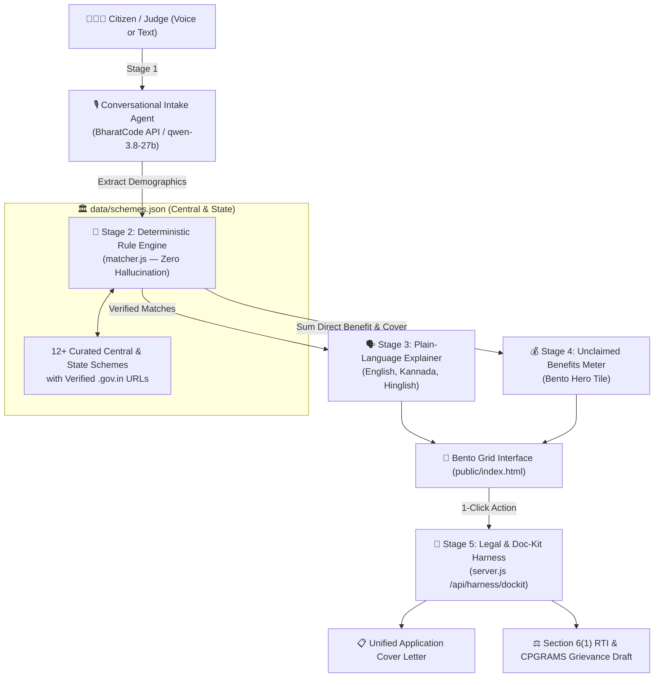

# 🇮🇳 Hakku (ಹಕ್ಕು / हक़) — *"Find every rupee the government already owes you."*

> **BharatCode Build League 2026 Submission** • **Author:** SHAMITH R (`@rshamith-cpu`) • **Track:** Everyday Assistance • **Powered by:** BharatCode Model API (`qwen-3.8-27b`)

India runs **3,000+ central and state welfare schemes**—scholarships, pensions, farm subsidies, health cover, and women empowerment grants. Yet millions of eligible citizens leave tens of thousands of rupees unclaimed every year because:
1. They don't know which schemes they qualify for.
2. Portal eligibility rules are buried in bureaucratic PDFs.
3. When an application is stuck or rejected, citizens don't know how to draft a formal **Section 6(1) RTI** or **CPGRAMS Grievance**.

**Hakku** is a 5-stage AI + Deterministic Rule Engine harness that turns *"I don't know my rights"* into a **verified Unclaimed Benefits Meter + Printable Application & RTI Kit** in under 30 seconds.

---

## 🍱 Modern Bento Grid Design
Hakku is built around a modern **Bento Grid Architecture**:
- **Hero Bento Meter:** Real-time animated counter summing direct annual cash benefits (`₹/year`) + cashless hospitalization (`₹5,00,000/year`).
- **1-Click Judge Persona Bento:** Instant evaluation with real profiles (*Aarav 19 Student*, *Lakshmi 67 Rural Widow*, *Ramesh 41 Farmer*).
- **Conversational Intake Bento:** Multilingual voice/text input supporting English, Kannada (ಕನ್ನಡ), and Hinglish with live AI guidance.
- **Deterministic Parameter Dials:** Pure rule controls (Age, Income, Occupation, Category, BPL, Widow status) for zero-hallucination verification.
- **Consolidated Document Kit Bento:** Deduplicated checklist so citizens make only *one* trip to Seva Sindhu / CSC.
- **Verified Scheme Bento Gallery:** Transparent cards displaying level, ministry, direct annual gain, eligibility reasons, and direct links to `.gov.in` portals.

---

## 🧠 Why Hakku Beats Standard Chatbots & Portals (Judge FAQ)

| Question | Generic LLM (ChatGPT) | Govt Portals (`myScheme`) | **Hakku (BharatCode Harness)** |
|---|---|---|---|
| **Hallucinates fake schemes or dead links?** | ❌ Frequently invents closed/fake schemes | ✅ Verified | ✅ **Zero Hallucination:** Eligibility is matched 100% by a deterministic JS Rule Engine (`matcher.js`) |
| **Calculates total unclaimed ₹/year?** | ❌ No | ❌ Only lists schemes | ✅ **Unclaimed Benefits Meter** sums exact annual cash + health cover |
| **Deduplicates required documents?** | ❌ No | ❌ Separate per page | ✅ **Single-Window Checklist** across all matched schemes |
| **What if the office delays/rejects?** | ❌ Generic advice | ❌ Dead end | ✅ **1-Click Section 6(1) RTI Act, 2005 & CPGRAMS Draft Generator** |
| **Zero-PII Scam Protection?** | ⚠️ Unstructured | ⚠️ Requires OTP login | ✅ **Never asks for Aadhaar numbers, OTPs, or bank account numbers** |

---

## ⚙️ The 5-Stage Harness Architecture



---

## 🚀 Quickstart (Run in 30 Seconds)

### 1. Prerequisites
- **Node.js** v18+ (tested on Node 26)
- **npm** v9+

### 2. Installation
```bash
git clone https://github.com/rshamith-cpu/hakku-ai.git
cd hakku-ai
npm install
```

### 3. Environment Configuration
```bash
cp .env.example .env
```
*(Includes full offline demo fallback so judges can test instantly even without active API credentials.)*

### 4. Start the Application
```bash
npm start
```
Open **[http://localhost:3000](http://localhost:3000)** in your browser!

---

## 📝 Step 03 Submission Details for BharatCode Website

1. On **STEP 02** of the BharatCode page, click **"Everyday assistance"**.
2. Push this repo to `https://github.com/rshamith-cpu/hakku-ai` and paste these into **STEP 03**:

* **Project name:**
  `Hakku (ಹಕ್ಕು / हक़) — Zero-Hallucination Welfare Discovery, Benefits Meter & RTI Harness`
* **GitHub repo URL:**
  `https://github.com/rshamith-cpu/hakku-ai`
* **Short summary:**
  > Millions of Indians leave ₹50,000–₹1,50,000/year in scholarships, pensions, and farm subsidies unclaimed because rules are buried in bureaucratic portals—while generic LLMs hallucinate fake schemes. Hakku is a 5-stage AI harness powered by the BharatCode API (qwen-3.8-27b) that turns "I don't know my rights" into a ready-to-print application kit in 30 seconds: (1) Multilingual Voice/Text Intake in English, Kannada, and Hinglish, (2) A 100% deterministic JS Eligibility Rule Engine so the AI never hallucinates a scheme, (3) Plain-language scheme cards with official .gov.in links in a modern Bento Grid UI, (4) An Unclaimed Benefits Meter summing annual direct cash + ₹5L health cover, and (5) A 1-click Document Checklist, Application Letter, and Section 6(1) RTI / CPGRAMS Grievance generator if benefits are delayed.
