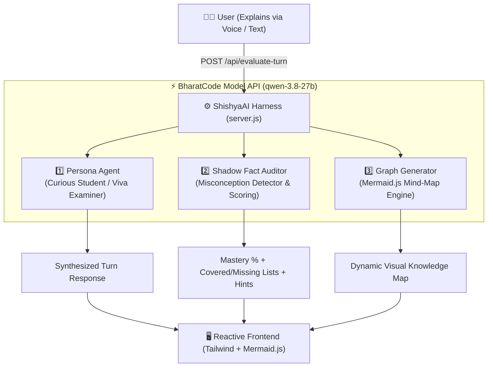

# 🧠 ShishyaAI — The Reverse-Tutor & Viva Mastery Harness
### *Master Concepts by Teaching an AI Student (The Feynman Technique) • Powered by BharatCode API*

[](https://github.com/rshamith-cpu/ShishyaAI)
[](https://github.com/rshamith-cpu/ShishyaAI)
[](https://api.bharatcode.ai)
[-purple.svg)](https://github.com/rshamith-cpu)

---

## 💡 The Core Problem: The Passive Learning Trap
Most educational AI apps are simple **"Question ➔ Answer" chatbots** or **"PDF Quiz Generators"**. They make students passive consumers of information:
- Students copy-paste questions, read generated answers, and get a false illusion of competence.
- When facing real viva exams, technical interviews, or system design challenges, students choke because they never practiced explaining the concepts themselves.

> *"If you want to master something, teach it."* — **Richard Feynman**

---

## 🏆 The Solution: Reverse-Tutoring with ShishyaAI
**ShishyaAI** (`Shishya` = Student in Sanskrit) flips the traditional education paradigm on its head:
1. **You are the Teacher; AI is the Student:** You choose a topic (or select a 1-click preset) and explain it in your own words using Voice or Text.
2. **True Multi-Agent Harness:** Instead of a single chat completion, your explanation triggers an orchestrated 3-stage harness:
   * **Persona Agent:** Steps into character (Curious 1st-Year Student, Strict Viva Examiner, or Senior Systems Engineer) and responds in English, Hinglish, or Kannada + English. It never gives away the answer—it questions missing gaps.
   * **Shadow Fact-Auditor:** Analyzes your response for factual accuracy, isolates misconceptions, and computes a **Live Concept Mastery Score (0–100%)**.
   * **Dynamic Graph Generator:** Synthesizes a real-time **Mermaid.js Knowledge Map**, highlighting understood sub-concepts in green and blind spots in red.

---

## 🏗️ Harness Architecture



---

## ✨ Key Features
- **1-Click Presets for Rapid Evaluation:** Instantly test topics like *Operating System Deadlocks*, *React Hooks & Lifecycle*, or *UPI Payment Architecture*.
- **🎙️ Web Speech Voice Input:** Speak your explanations naturally—ideal for viva preparation.
- **🇮🇳 Indic & Regional Language Flexibility:** Support for English, Hinglish (Hindi + Tech English), and Kannada + Tech English.
- **📊 Real-Time Visual Knowledge Graph:** Color-coded node graph directly renders covered vs. uncovered concepts.
- **🛡️ Intelligent Fallback Demo Mode:** Runs seamlessly for judges out-of-the-box even before API credentials are configured.

---

## 📁 Repository Structure
```text
ShishyaAI/
├── BharatCode.txt       # Hackathon verification metadata (Mandatory)
├── package.json         # Dependencies and scripts
├── .env.example         # Environment variable template
├── .env                 # Local environment config
├── .gitignore           # Git ignore rules
├── server.js            # Multi-Agent BharatCode API Harness
├── public/
│   └── index.html       # Single-page UI with Tailwind & Mermaid.js
└── README.md            # Comprehensive project documentation
```

---

## 🚀 Quick Start Guide

### 1. Prerequisites
- **Node.js** v18+ (tested on v26+)
- **npm** v9+

### 2. Installation
```bash
git clone https://github.com/rshamith-cpu/ShishyaAI.git
cd ShishyaAI
npm install
```

### 3. Environment Configuration
Copy `.env.example` to `.env` and provide your credentials (optional—fallback demo mode is enabled by default):
```env
BHARATCODE_API_KEY=your_bharatcode_api_key_here
BHARATCODE_BASE_URL=https://api.bharatcode.ai/v1
BHARATCODE_MODEL=qwen-3.8-27b
PORT=3000
```

### 4. Run the Application
```bash
npm start
```
Open **[http://localhost:3000](http://localhost:3000)** in your browser!

---

## 🧪 Testing the 3-Step Harness

1. **Step 1:** Select the **"OS Deadlocks"** preset button.
2. **Step 2:** Click **"Insert Sample Explanation"** (or speak via microphone).
3. **Step 3:** Click **"Teach ShishyaAI →"**.
4. **Observe the Harness Output:**
   - ShishyaAI probes your answer with a targeted follow-up question.
   - Concept Mastery Score jumps to 30%+.
   - Live Knowledge Map turns "Core Definition" and "Basic Flow" green, while "Edge Conditions" and "Tradeoffs" show as red gaps.

---

## 📜 BharatCode Hackathon Submission Details
- **Project Name:** ShishyaAI - The Reverse-Tutor & Viva Mastery Harness
- **Track:** Learning & Education
- **Author:** SHAMITH R ([@rshamith-cpu](https://github.com/rshamith-cpu))
- **Powered By:** BharatCode Model API (`qwen-3.8-27b`)
- **Repository:** [https://github.com/rshamith-cpu/ShishyaAI](https://github.com/rshamith-cpu/ShishyaAI)

---

## 📄 License
MIT License. Built for the **BharatCode Build League 2026**.

