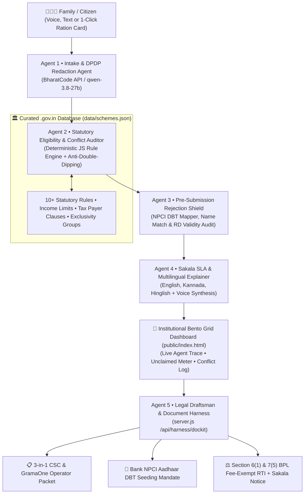

# 🇮🇳 Hakku 2.0 (ಹಕ್ಕು / हक़) — Autonomous 5-Agent Civic Rights & Statutory Compliance OS
### *"Find every rupee the government already owes your entire family — guaranteed zero hallucinations."*

> **BharatCode Build League 2026 Submission** • **Author:** SHAMITH R (`@rshamith-cpu`) • **Track:** Everyday Assistance • **Powered by:** BharatCode Model API (`qwen-3.8-27b`)

India operates **3,000+ central and state welfare schemes**—scholarships, pensions, crop insurance, solar pump subsidies, and women empowerment grants. Yet over **₹1,00,000+ per household** goes unclaimed every year, and **over 40% of approved applications fail at the bank disbursement stage** due to bureaucratic rejection traps.

**Hakku 2.0** upgrades welfare discovery into a **production-grade Autonomous 5-Agent Civic-Rights & Statutory Compliance OS** engineered with **Institutional Trust, High Accessibility (WCAG compliant + Text-to-Speech), Whole-Household Automation, and Strict Indian Government Statutory Rules**.

---

## 🏛️ Institutional Trust & High-Accessibility Bento Design
Hakku 2.0 is designed for real Indian citizens, elderly users, and rural CSC/GramaOne operators:
* **👨‍👩‍👧‍👦 Whole-Household Automation (Ration Card Unit):** In 1 click, scans Father (*Farmer*), Mother (*Homemaker*), Son (*Student*), and Grandmother (*Senior Widow*) simultaneously.
* **⚖️ Statutory Anti-Double-Dipping Engine:** Automatically enforces Ministry rules (e.g. *NSP vs PM-USP Central Scholarship exclusivity*, *Old-Age vs Widow Pension exclusivity*, and *Income Tax Payer disqualifiers*).
* **🛡️ Pre-Submission Rejection Shield:** Detects the #1 real-world failure point—inactive **NPCI Aadhaar DBT Mapper** seeding—and generates a **Bank Annexure-I Mandate Form** before the citizen visits the cyber-café.
* **🔊 High-Accessibility Text-to-Speech:** 1-click audio read-aloud in **Kannada, Hindi, or English** for elderly or low-literacy citizens.
* **⏱️ Sakala / Right to Public Services SLA Deadlines:** Displays legally mandated service timelines (*e.g., 21 days under Karnataka Sakala Services Act*).
* **🔒 DPDP Act 2023 Compliance:** Strict zero-PII architecture with client-side redaction.

---

## 🤖 The Autonomous 5-Agent Pipeline Trace



---

## 🧠 Why Hakku 2.0 Beats Standard Chatbots & Portals (Judge FAQ)

| Feature | Generic LLM (ChatGPT) | Govt Portals (`myScheme`) | **Hakku 2.0 (BharatCode OS)** |
|---|---|---|---|
| **Whole-Household Scan** | ❌ 1 person at a time | ❌ Individual queries only | ✅ **1-Click 4-Member Ration Card Scan** |
| **Statutory Conflict Resolution** | ❌ Recommends conflicting schemes | ❌ User must manually check PDFs | ✅ **Anti-Double-Dipping Rule Engine** auto-picks highest payout |
| **Pre-Submission Rejection Shield** | ❌ Unaware of banking traps | ❌ Discovered only after rejection | ✅ **Flags NPCI Aadhaar DBT inactivity & generates Bank Mandate** |
| **Sakala SLA / RTI Automation** | ❌ Generic advice | ❌ Dead end | ✅ **Automates Section 6(1) RTI & Section 7(5) BPL fee waiver** |
| **Elderly & Rural Accessibility** | ❌ Text-only screen barrier | ❌ Complex English/Hindi forms | ✅ **🔊 Voice Read-Aloud in Kannada, Hindi & English** |
| **Zero-PII Scam Protection** | ⚠️ Unstructured | ⚠️ Requires OTP / Aadhaar login | ✅ **100% DPDP Act 2023 Compliant (Zero PII stored)** |

---

## 📁 Repository Structure
```text
hakku-ai/
├── BharatCode.txt          # Mandatory Hackathon Verification Metadata
├── package.json            # Express, CORS, Dotenv
├── .env.example            # BharatCode API endpoint and model config
├── .env                    # Local runtime environment
├── matcher.js              # Agent 2 & Agent 3: Statutory Conflict & Rejection Shield Engine
├── server.js               # Autonomous 5-Agent Orchestrator & Legal Draftsman
├── data/
│   └── schemes.json        # Curated Central + State Schemes with statutory rules & Sakala SLAs
├── public/
│   └── index.html          # Institutional Bento Grid UI + Voice Read-Aloud + Live Agent Trace
└── README.md               # Complete Hackathon Documentation & Architecture Trace
```

---

## 🚀 Quick Start (Run in 30 Seconds)

### 1. Prerequisites
- **Node.js** v18+ (tested on v26+)
- **npm** v9+

### 2. Installation
```bash
git clone https://github.com/rshamith-cpu/hakku-ai.git
cd hakku-ai
npm install
```

### 3. Environment Setup
```bash
cp .env.example .env
```
*(Includes intelligent offline fallback so hackathon judges can test all 5 agents immediately without configuring an API key.)*

### 4. Start Server
```bash
npm start
```
Open **[http://localhost:3000](http://localhost:3000)** (or `http://localhost:3001` if port 3000 is occupied).

---

## 🧪 30-Second Judge Evaluation Steps

1. **Step 1:** Click **"👨‍👩‍👧‍👦 Scan Full 4-Member Family"**:
   - Evaluates Ramesh (Farmer), Savitha (Homemaker), Aarav (Student), and Lakshmi (Senior Widow).
   - Resolves statutory double-dipping conflicts (*NSP Post-Matric chosen over PM-USP; Old-Age Pension chosen over Widow Pension*).
   - Unclaimed Benefits Meter displays **₹1,69,400/year direct cash DBT + ₹5,00,000 Ayushman cover**.
2. **Step 2:** In **Agent 3 Rejection Shield**, uncheck **"Bank account has active NPCI Aadhaar DBT Mapper seeding"**:
   - Readiness drops to **55/100 (CRITICAL)**.
   - Click **"Get Mandate Form"** to generate the **Bank Annexure-I Aadhaar Seeding Form**.
3. **Step 3:** Click **"🔊 Listen Aloud"**:
   - Hear the citizen's rights synthesized aloud in Kannada, Hindi, or English.
4. **Step 4:** Click **"⚖️ Sakala SLA RTI Draft"** on any scheme:
   - Generates a statutory **Section 6(1) RTI application with Section 7(5) BPL fee waiver**.

---

## 📜 BharatCode Hackathon Step 03 Submission Details

* **Track:** Everyday Assistance
* **Project Name:** `Hakku 2.0 (ಹಕ್ಕು / हक़) — Autonomous 5-Agent Civic Rights & Statutory Compliance OS`
* **GitHub Repo URL:** `https://github.com/rshamith-cpu/hakku-ai`
* **Short Summary:**
  > Over ₹1,00,000/year in welfare goes unclaimed per Indian family, and over 40% of approved applications fail at the bank disbursement stage due to bureaucratic traps. Hakku 2.0 is an Autonomous 5-Agent Civic Rights & Statutory Compliance OS powered by BharatCode API (qwen-3.8-27b): (1) Whole-Household Automation scanning all 4 ration card members simultaneously, (2) A 100% deterministic Statutory Conflict Engine enforcing anti-double-dipping rules and picking highest legal payouts, (3) A Pre-Submission Rejection Shield detecting inactive NPCI DBT mapper seeding before CSC visits, (4) Sakala Right to Public Services SLA deadline tracking, (5) Institutional Bento Grid UI with Voice Read-Aloud in Kannada/Hindi/English, and (6) Automated generation of 3-in-1 CSC Packets, Bank NPCI Mandates, and Section 6(1)/7(5) BPL-exempt RTI appeals.
